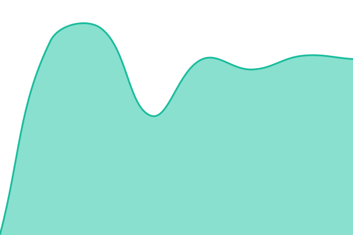
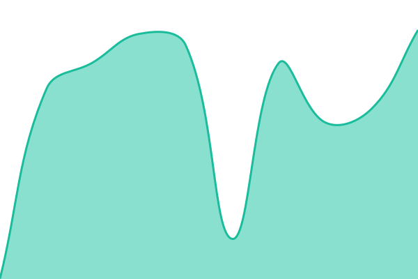
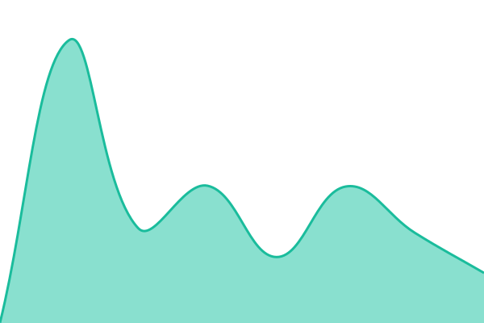
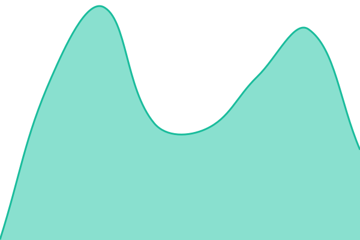

# [📈 Live Status](https://status.rocknite-studio.com): <!--live status--> **🟧 Partial outage**

This repository contains the open-source uptime monitor and status page for [ROCKNITE-STUDIO](https://status.rocknite-studio.com), powered by [Upptime](https://github.com/upptime/upptime).

With [Upptime](https://upptime.js.org), you can get your own unlimited and free uptime monitor and status page, powered entirely by a GitHub repository. We use [Issues](https://github.com/ROCKNITE-STUDIO/status/issues) as incident reports, [Actions](https://github.com/ROCKNITE-STUDIO/status/actions) as uptime monitors, and [Pages](https://status.rocknite-studio.com) for the status page.

<!--start: status pages-->
<!-- This summary is generated by Upptime (https://github.com/upptime/upptime) -->
<!-- Do not edit this manually, your changes will be overwritten -->
<!-- prettier-ignore -->

### Web

| URL | Status | History | Response Time | Uptime |
| --- | ------ | ------- | ------------- | ------ |
|  [Site principal](https://rocknite-studio.com) | 🟥 Down | [web-site-principal.yml](https://github.com/ROCKNITE-STUDIO/status/commits/HEAD/history/web-site-principal.yml) | 

 469ms
     
 | 

<a href="https://status.rocknite-studio.com/history/web-site-principal">96.11%</a>
    

|  [Compte](https://account.rocknite-studio.com) | 🟩 Up | [web-compte.yml](https://github.com/ROCKNITE-STUDIO/status/commits/HEAD/history/web-compte.yml) | 

 501ms
     
 | 

<a href="https://status.rocknite-studio.com/history/web-compte">96.11%</a>
    

|  [Wiki](https://wiki.rocknite-studio.com) | 🟩 Up | [web-wiki.yml](https://github.com/ROCKNITE-STUDIO/status/commits/HEAD/history/web-wiki.yml) | 

 558ms
     
 | 

<a href="https://status.rocknite-studio.com/history/web-wiki">96.11%</a>
    

|  [Leaderboard](https://leaderboard.rocknite-studio.com) | 🟩 Up | [web-leaderboard.yml](https://github.com/ROCKNITE-STUDIO/status/commits/HEAD/history/web-leaderboard.yml) | 

 461ms
     
 | 

<a href="https://status.rocknite-studio.com/history/web-leaderboard">96.11%</a>
    

|  [CDN](https://cdn.rocknite-studio.com/status) | 🟩 Up | [web-cdn.yml](https://github.com/ROCKNITE-STUDIO/status/commits/HEAD/history/web-cdn.yml) | 

 469ms
     
 | 

<a href="https://status.rocknite-studio.com/history/web-cdn">96.11%</a>
    

### API

| URL | Status | History | Response Time | Uptime |
| --- | ------ | ------- | ------------- | ------ |
|  [Global](https://api.rocknite-studio.com/status) | 🟩 Up | [api-global.yml](https://github.com/ROCKNITE-STUDIO/status/commits/HEAD/history/api-global.yml) | 

 459ms
     
 | 

<a href="https://status.rocknite-studio.com/history/api-global">96.12%</a>
    

|  [Auth](https://api.rocknite-studio.com/status) | 🟩 Up | [api-auth.yml](https://github.com/ROCKNITE-STUDIO/status/commits/HEAD/history/api-auth.yml) | 

 390ms
     
 | 

<a href="https://status.rocknite-studio.com/history/api-auth">96.12%</a>
    

|  [Catalog](https://api.rocknite-studio.com/status) | 🟩 Up | [api-catalog.yml](https://github.com/ROCKNITE-STUDIO/status/commits/HEAD/history/api-catalog.yml) | 

 356ms
     
 | 

<a href="https://status.rocknite-studio.com/history/api-catalog">96.12%</a>
    

|  [Wallet](https://api.rocknite-studio.com/status) | 🟩 Up | [api-wallet.yml](https://github.com/ROCKNITE-STUDIO/status/commits/HEAD/history/api-wallet.yml) | 

 393ms
     
 | 

<a href="https://status.rocknite-studio.com/history/api-wallet">96.12%</a>
    

### ROCKNITE ONLINE

| URL | Status | History | Response Time | Uptime |
| --- | ------ | ------- | ------------- | ------ |
|  [Jeu](https://online.rocknite-studio.com) | 🟩 Up | [rocknite-online-jeu.yml](https://github.com/ROCKNITE-STUDIO/status/commits/HEAD/history/rocknite-online-jeu.yml) | 

 473ms
     
 | 

<a href="https://status.rocknite-studio.com/history/rocknite-online-jeu">96.12%</a>
    

|  [Services](https://online-services.rocknite-studio.com/status) | 🟩 Up | [rocknite-online-services.yml](https://github.com/ROCKNITE-STUDIO/status/commits/HEAD/history/rocknite-online-services.yml) | 

 484ms
     
 | 

<a href="https://status.rocknite-studio.com/history/rocknite-online-services">96.13%</a>
    

|  [Nodes](https://nodes.rocknite-studio.com) | 🟩 Up | [rocknite-online-nodes.yml](https://github.com/ROCKNITE-STUDIO/status/commits/HEAD/history/rocknite-online-nodes.yml) | 

 458ms
     
 | 

<a href="https://status.rocknite-studio.com/history/rocknite-online-nodes">96.13%</a>
    

### Minecraft

| URL | Status | History | Response Time | Uptime |
| --- | ------ | ------- | ------------- | ------ |
|  [mc](https://mc.rocknite-studio.com) | 🟩 Up | [minecraft-mc.yml](https://github.com/ROCKNITE-STUDIO/status/commits/HEAD/history/minecraft-mc.yml) | 

 500ms
     
 | 

<a href="https://status.rocknite-studio.com/history/minecraft-mc">96.13%</a>
    

<!--end: status pages-->

[**Visit our status website →**](https://status.rocknite-studio.com)

## 📄 License

- Powered by: [Upptime](https://github.com/upptime/upptime)
- Code: [MIT](./LICENSE) © [Anand Chowdhary](https://anandchowdhary.com)
- Data in the `./history` directory: [Open Database License](https://opendatacommons.org/licenses/odbl/1-0/)
