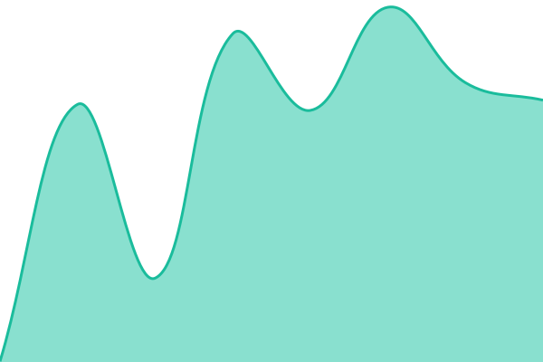
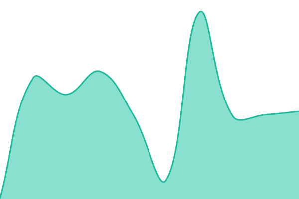
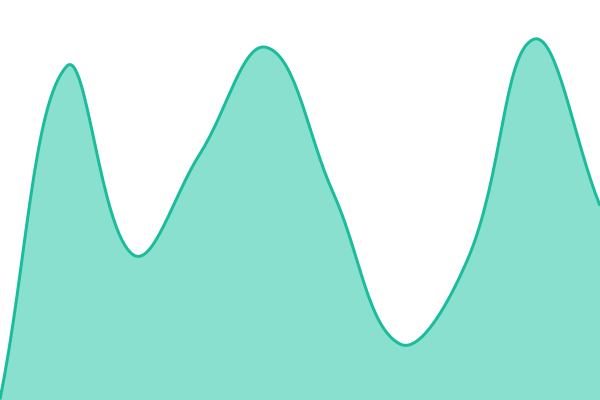

# [📈 Live Status](https://status.rocknite-studio.com): <!--live status--> **🟩 All systems operational**

This repository contains the open-source uptime monitor and status page for [ROCKNITE-STUDIO](https://status.rocknite-studio.com), powered by [Upptime](https://github.com/upptime/upptime).

With [Upptime](https://upptime.js.org), you can get your own unlimited and free uptime monitor and status page, powered entirely by a GitHub repository. We use [Issues](https://github.com/ROCKNITE-STUDIO/status/issues) as incident reports, [Actions](https://github.com/ROCKNITE-STUDIO/status/actions) as uptime monitors, and [Pages](https://status.rocknite-studio.com) for the status page.

<!--start: status pages-->
<!-- This summary is generated by Upptime (https://github.com/upptime/upptime) -->
<!-- Do not edit this manually, your changes will be overwritten -->
<!-- prettier-ignore -->
| URL | Status | History | Response Time | Uptime |
| --- | ------ | ------- | ------------- | ------ |
|  [Web · Site principal](https://rocknite-studio.com) | 🟩 Up | [web-site-principal.yml](https://github.com/ROCKNITE-STUDIO/status/commits/HEAD/history/web-site-principal.yml) | 

 488ms
     
 | 

<a href="https://status.rocknite-studio.com/history/web-site-principal">98.01%</a>
    

|  [Web · Compte](https://account.rocknite-studio.com) | 🟩 Up | [web-compte.yml](https://github.com/ROCKNITE-STUDIO/status/commits/HEAD/history/web-compte.yml) | 

 484ms
     
 | 

<a href="https://status.rocknite-studio.com/history/web-compte">98.01%</a>
    

|  [Web · Wiki](https://wiki.rocknite-studio.com) | 🟩 Up | [web-wiki.yml](https://github.com/ROCKNITE-STUDIO/status/commits/HEAD/history/web-wiki.yml) | 

 523ms
     
 | 

<a href="https://status.rocknite-studio.com/history/web-wiki">98.02%</a>
    

|  [Web · Leaderboard](https://leaderboard.rocknite-studio.com) | 🟩 Up | [web-leaderboard.yml](https://github.com/ROCKNITE-STUDIO/status/commits/HEAD/history/web-leaderboard.yml) | 

 539ms
     
 | 

<a href="https://status.rocknite-studio.com/history/web-leaderboard">98.02%</a>
    

|  [Web · CDN](https://cdn.rocknite-studio.com/status) | 🟩 Up | [web-cdn.yml](https://github.com/ROCKNITE-STUDIO/status/commits/HEAD/history/web-cdn.yml) | 

 465ms
     
 | 

<a href="https://status.rocknite-studio.com/history/web-cdn">98.02%</a>
    

|  [API · Global](https://api.rocknite-studio.com/status) | 🟩 Up | [api-global.yml](https://github.com/ROCKNITE-STUDIO/status/commits/HEAD/history/api-global.yml) | 

 493ms
     
 | 

<a href="https://status.rocknite-studio.com/history/api-global">98.02%</a>
    

|  [API · Auth](https://api.rocknite-studio.com/status) | 🟩 Up | [api-auth.yml](https://github.com/ROCKNITE-STUDIO/status/commits/HEAD/history/api-auth.yml) | 

 406ms
     
 | 

<a href="https://status.rocknite-studio.com/history/api-auth">98.02%</a>
    

|  [API · Catalog](https://api.rocknite-studio.com/status) | 🟩 Up | [api-catalog.yml](https://github.com/ROCKNITE-STUDIO/status/commits/HEAD/history/api-catalog.yml) | 

 379ms
     
 | 

<a href="https://status.rocknite-studio.com/history/api-catalog">98.02%</a>
    

|  [API · Wallet](https://api.rocknite-studio.com/status) | 🟩 Up | [api-wallet.yml](https://github.com/ROCKNITE-STUDIO/status/commits/HEAD/history/api-wallet.yml) | 

 335ms
     
 | 

<a href="https://status.rocknite-studio.com/history/api-wallet">98.03%</a>
    

|  [ROCKNITE ONLINE · Jeu](https://online.rocknite-studio.com) | 🟩 Up | [rocknite-online-jeu.yml](https://github.com/ROCKNITE-STUDIO/status/commits/HEAD/history/rocknite-online-jeu.yml) | 

 484ms
     
 | 

<a href="https://status.rocknite-studio.com/history/rocknite-online-jeu">98.03%</a>
    

|  [ROCKNITE ONLINE · Services](https://online-services.rocknite-studio.com/status) | 🟩 Up | [rocknite-online-services.yml](https://github.com/ROCKNITE-STUDIO/status/commits/HEAD/history/rocknite-online-services.yml) | 

 487ms
     
 | 

<a href="https://status.rocknite-studio.com/history/rocknite-online-services">98.03%</a>
    

|  [ROCKNITE ONLINE · Nodes](https://nodes.rocknite-studio.com) | 🟩 Up | [rocknite-online-nodes.yml](https://github.com/ROCKNITE-STUDIO/status/commits/HEAD/history/rocknite-online-nodes.yml) | 

 461ms
     
 | 

<a href="https://status.rocknite-studio.com/history/rocknite-online-nodes">98.03%</a>
    

|  [Minecraft · mc](https://mc.rocknite-studio.com) | 🟩 Up | [minecraft-mc.yml](https://github.com/ROCKNITE-STUDIO/status/commits/HEAD/history/minecraft-mc.yml) | 

 492ms
     
 | 

<a href="https://status.rocknite-studio.com/history/minecraft-mc">98.03%</a>
    

<!--end: status pages-->

[**Visit our status website →**](https://status.rocknite-studio.com)

## 📄 License

- Powered by: [Upptime](https://github.com/upptime/upptime)
- Code: [MIT](./LICENSE) © [Anand Chowdhary](https://anandchowdhary.com)
- Data in the `./history` directory: [Open Database License](https://opendatacommons.org/licenses/odbl/1-0/)
